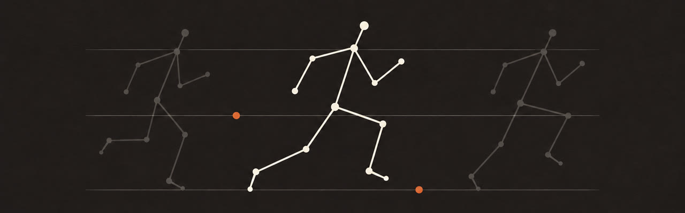

# HE Pose MTG



HE研究室の3人・90分向けの姿勢推定ハンズオンです。Macのカメラで試し、同じ録画を3モデルで見比べます。

[比較結果](#比較結果) · [MTGガイド](docs/mtg/guide.md) · [abertで始める](#abertで最初に試す) · [Macでライブ](#macからyolo26を遠隔実行する)

## できること

- **ライブ**　Macのカメラ映像をSSHでLinuxへ送り、RTX 3090で推定した骨格をMacで元の映像に重ねます。
- **録画比較**　同じMP4を3モデルで処理し、元フレームと時刻を揃えて横並びで再生します。
- **計測**　同じGPU・同じ100フレームで順番に実行し、処理FPS、推論時間、環境を保存します。

ライブは一度に1フレームを送り、処理中に届いた画像は最新の1枚だけを待機させます。録画では入力順を保ち、TARの前後各2フレームを `NOT ESTIMATED` と表示します。

### 3つのモデル

| モデル | 推定に使う画像 | MTGでの役割 |
| --- | --- | --- |
| **YOLO26n-Pose** | 1枚 | 全員がMacからライブを操作し、録画も処理 |
| **DETRPose-N** | 1枚 | 全員がYOLO26と同じ録画を処理 |
| **TAR-ViTPose Base** | 中心と前後2枚、計5枚 | 代表環境でオフライン実演。人物の領域はYOLO11xで取得 |

## 比較結果

**YOLO26n-Poseが3素材すべてで最速でした。** 速い動きの素材で人物を1人も出力しなかったフレームは、DETRPose-Nが最少でした。関節の正解座標がないため、姿勢推定の精度順位は未評価です。

| 素材 | YOLO26n-Pose | DETRPose-N | TAR-ViTPose Base |
| --- | ---: | ---: | ---: |
| `basic` · 1人の腕上げ | **178.69** | 68.56 | 16.78 |
| `fast` · 速い反復動作 | **178.00** | 66.51 | 20.36 |
| `multi` · 複数人の交差 | **163.02** | 65.27 | 5.80 |

表は録画処理FPSです。2026年11月5日にabertのRTX 3090で、PyTorch・FP32・batch=1を使い、共通の20枚でウォームアップした後の100枚を測定しました。TARの値にはYOLO11xによる人物検出と切り出しを含みます。

`fast` の共通371フレームで人物が0件だったのは、YOLO26が15枚、DETRPoseが6枚、TARが55枚でした。この件数には各モデルの検出閾値が影響し、主役を捉えた割合は分かりません。 [詳しい分析と集計CSV](docs/experiments/pose-analysis-2026-11-05/README.md) · [実行記録](docs/experiments/mtg-abert-2026-11-05.json)

abertでは3素材の録画推論・同期比較と、LinuxからのSSH録画再送を確認済みです。参加者3人のMac実機でのカメラ・表示・結果回収は、[受入表](docs/mtg/acceptance.md)で個別に確認します。

## セットアップ

手順は `ssh abert` で接続済みのタブから始めます。abertでは `cd /home/taku/he-pose-mtg` で作業場所に移動します。Macのカメラ表示とファイル回収には、Macの別タブを使います。各環境にPython 3.11とuvを用意し、同じコミットを使います。

| 端末 | 共通CLIの準備 | 追加の準備 |
| --- | --- | --- |
| **Mac** | `uv sync --frozen --extra client` | GUI版OpenCV・カメラの使用許可・既存のSSH設定 |
| **Linux GPU** | `uv sync --frozen --extra video` | FFmpeg・モデル別Python環境・公式重み・割当GPU |

Linuxで [設定例](hepose.example.toml) を `hepose.local.toml` にコピーし、各モデルの `python`、`device`、`gpu_uuid` と重みのパスを設定します。用意するモデルに合わせて、次の手順を選んでください。

- **YOLO26n-Pose** — [インストール・重み・スモークテスト](docs/setup.md#yolo26n-poseの準備とgpu検証)
- **DETRPose-N** — [インストール・重み・スモークテスト](docs/setup.md#detrpose-nの準備とgpu検証)
- **TAR-ViTPose** — [代表環境の準備と検証](docs/setup.md#tar-vitposeの準備とgpu検証)

### abertで最初に試す

ターミナルの表示が `taku@abert` なら、このブロックから始めます。GPU側を確認し、[配布素材](docs/mtg/sample-sources.md)の `basic.mp4` を1本処理します。

```bash
cd /home/taku/he-pose-mtg &&
.venv/bin/python -m hepose.cli doctor --role worker --model yolo26 &&
.venv/bin/python -m hepose.cli run --model yolo26 \
  --input assets/sample/basic.mp4 \
  --output "outputs/basic-yolo26-$(date +%Y%m%d-%H%M%S)"
```

`annotated.mp4` に骨格を重ねた映像、`poses.jsonl` に元画像上の関節座標、`timings.csv` に時間、`summary.json`・`environment.json`・`run.log` に実行記録を保存します。[入出力の仕様](docs/setup.md#動画と結果の契約)

## MacからYOLO26を遠隔実行する


abertに接続済みのタブを開いたまま、**SSHに入っていないMacの別タブ**でMac側のリポジトリへ移動します。`uname -s` で `Darwin` と出るタブです。`doctor --role client` はここで実行します。ライブはMacの `abert` SSH設定を使います。abert側では、YOLO26とGPU UUIDの設定、SSHサーバーでのループバック宛TCP転送の許可を済ませておきます。

```bash
if [ "$(uname -s)" = Darwin ]; then
  .venv/bin/python -m hepose.cli doctor --role client &&
  .venv/bin/python -m hepose.cli live --camera 0 \
    --remote abert --remote-root /home/taku/he-pose-mtg --show-fps
else
  printf '%s\n' 'ライブはMacの別タブで起動してください。' >&2
fi
```

ウィンドウの `q` またはターミナルの Ctrl+C で終了します。出力先の `summary.json` で表示FPS・アプリ内遅延・待機画像の置き換え数を確認できます。動画を保存する場合は `--record` を指定します。[ライブ設定とトラブル時の確認](docs/setup.md#ライブ設定と記録)

## 3モデルを計測して比較動画を作る

**接続済みのabertのタブ**で実行します。3モデルに同じ割当GPUのUUIDを設定し、同じ素材を使います。計測が成功すると比較動画を作ります。

```bash
cd /home/taku/he-pose-mtg &&
root="outputs/benchmark-$(date +%Y%m%d-%H%M%S)" &&
.venv/bin/python -m hepose.cli benchmark --models yolo26,detrpose,tar-vitpose \
  --input assets/sample/basic.mp4 --output "$root" &&
.venv/bin/python -m hepose.cli compare --input-dir "$root" \
  --output "$root/comparison.mp4" &&
printf '%s\n' "$root"
```

出力先を控え、**Macの別タブ**から `scp` で回収します。`comparison.mp4` と `report.md` はオフラインで閲覧できます。 [回収コマンドと比較の条件](docs/setup.md#比較と持ち帰り)

## MTG資料

| 資料 | 内容 |
| --- | --- |
| **[90分のMTGガイド](docs/mtg/guide.md)** | 進行表・実演台本・測定の読み方・当日の切替 |
| **[コマンド表](docs/mtg/commands.md)** | SSH接続・ライブ・計測・Macへの回収 |
| **[素材とSHA256](docs/mtg/sample-sources.md)** | `basic` の腕上げ、`fast` の反復動作、`multi` の交差と遮蔽 |
| **[受入表](docs/mtg/acceptance.md) / [観察メモ](docs/mtg/observations.md)** | 参加者ごとの結果と、次に試す仮説 |
| **[参考文献とライセンス](docs/mtg/references.md)** | モデル・重み・素材の出典と利用条件 |

開発者向けの入口は [実装仕様](docs/implementation-spec.md)、[テスト手順](docs/setup.md#テスト)、[CI](https://github.com/taku0193/he-pose-mtg/actions/workflows/ci.yml)、[開発ルール](AGENTS.md)、[引き継ぎ](HANDOFF.md) です。
