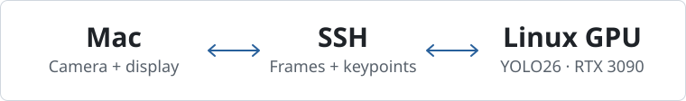

# HE Pose MTG

HE研究室の3人・90分向けの姿勢推定ハンズオンです。Macのカメラで試し、同じ録画を3モデルで見比べます。

[MTGガイド](docs/mtg/guide.md) · [準備](#セットアップ) · [ライブ](#macからyolo26を遠隔実行する) · [実測](#abertでの実測)



## できること

- **ライブ**　Macのカメラ映像をSSHでLinuxへ送り、RTX 3090で推定した骨格をMacで元の映像に重ねます。
- **録画比較**　同じMP4を3モデルで処理し、元フレームと時刻を揃えて横並びで再生します。
- **計測**　同じGPU・同じ100フレームで順番に実行し、処理FPS、推論時間、環境を保存します。

ライブは一度に1フレームを送り、処理中に届いた画像は最新の1枚だけを待機させます。録画では入力順を保ち、TARの前後各2フレームを `NOT ESTIMATED` と表示します。

### 3つのモデル

| モデル | 推定に使う画像 | MTGでの役割 |
| --- | --- | --- |
| **YOLO26n-Pose** | 1枚 | 全員がMacからライブを操作し、録画も処理 |
| **DETRPose-N** | 1枚 | 全員がYOLO26と同じ録画を処理 |
| **TAR-ViTPose** | 中心と前後2枚、計5枚 | 代表環境でオフライン実演。人物の領域はYOLO11xで取得 |

## abertでの実測

RTX 3090を1台使い、15秒・25 FPSの運動動画で計測しました。PyTorch・FP32・batch=1で、共通の20フレームでウォームアップし、続く100フレームを測定しています。

| 単フレームモデル | 録画処理FPS | モデル推論 p50 | モデル推論 p95 |
| --- | ---: | ---: | ---: |
| YOLO26n-Pose | **178.00** | 3.03 ms | 3.10 ms |
| DETRPose-N | **66.51** | 6.60 ms | 6.69 ms |

**TAR-ViTPose（オフライン）**は **20.36 FPS**。人物検出とクロップを含む処理速度です。TAR本体の推論時間は、人物を検出した77フレームで p50 **35.84 ms**、p95 **36.34 ms** でした。

録画処理FPSには復号・描画・フレーム単位の書き込みを含みます。推論時間はモデルのforwardを測った値です。精度はN/A（GTなし）。[実測の条件と集計](docs/pr-notes/benchmark.md) · [3素材の実行記録](docs/experiments/mtg-abert-2026-11-05.json)

abertでは3素材の録画推論・同期比較と、LinuxからのSSH録画再送を確認済みです。参加者3人のMac実機でのカメラ・表示・結果回収は、[受入表](docs/mtg/acceptance.md)で個別に確認します。

## セットアップ

Python 3.11とuvを用意し、同じコミットをMacとLinuxに置きます。コマンドは各端末のリポジトリ直下で実行します。

| 端末 | 共通CLIの準備 | 追加の準備 |
| --- | --- | --- |
| **Mac** | `uv sync --frozen --extra client` | GUI版OpenCV・カメラの使用許可・既存のSSH設定 |
| **Linux GPU** | `uv sync --frozen --extra video` | FFmpeg・モデル別Python環境・公式重み・割当GPU |

Linuxで [設定例](hepose.example.toml) を `hepose.local.toml` にコピーし、各モデルの `python`、`device`、`gpu_uuid` と重みのパスを設定します。用意するモデルに合わせて、次の手順を選んでください。

- **YOLO26n-Pose** — [インストール・重み・スモークテスト](docs/setup.md#yolo26n-poseの準備とgpu検証)
- **DETRPose-N** — [インストール・重み・スモークテスト](docs/setup.md#detrpose-nの準備とgpu検証)
- **TAR-ViTPose** — [代表環境の準備と検証](docs/setup.md#tar-vitposeの準備とgpu検証)

### 準備状態を確認する

Linuxで、用意したモデルを `doctor` で確認します。3モデルとも用意した環境では `--model all` を使えます。

```bash
.venv/bin/python -m hepose.cli doctor --model yolo26
.venv/bin/python -m hepose.cli doctor --model detrpose
```

### 録画を1本処理する

Linuxで[配布素材](docs/mtg/sample-sources.md)の `basic.mp4` を `assets/sample/` に置きます。モデルと新しい出力先を指定して実行します。

```bash
.venv/bin/python -m hepose.cli run --model yolo26 \
  --input assets/sample/basic.mp4 --output outputs/basic-yolo26
```

`annotated.mp4` に骨格を重ねた映像、`poses.jsonl` に元画像上の関節座標、`timings.csv` に時間、`summary.json`・`environment.json`・`run.log` に実行記録を保存します。[入出力の仕様](docs/setup.md#動画と結果の契約)

## MacからYOLO26を遠隔実行する

Macから既存のSSH鍵とホスト鍵でログインでき、LinuxのSSHサーバーでループバック宛のTCP転送が許可されていることを確認します。Linux側はYOLO26の準備とGPU UUIDの設定を済ませておきます。

```bash
# Mac側。SSH別名とLinux側の絶対パスを各自の値に置き換える
ssh_alias=YOUR_SSH_ALIAS
remote_root=/absolute/path/to/he-pose-mtg

.venv/bin/python -m hepose.cli doctor --role client &&
ssh -o BatchMode=yes -o StrictHostKeyChecking=yes "$ssh_alias" true &&
.venv/bin/python -m hepose.cli live --camera 0 \
  --remote "$ssh_alias" --remote-root "$remote_root" --show-fps
```

ウィンドウの `q` またはターミナルの Ctrl+C で終了します。出力先の `summary.json` で表示FPS・アプリ内遅延・待機画像の置き換え数を確認できます。動画を保存する場合は `--record` を指定します。[ライブ設定とトラブル時の確認](docs/setup.md#ライブ設定と記録)

## 3モデルを計測して比較動画を作る

Linuxで3モデルに同じ割当GPUのUUIDを設定し、同じ素材を使います。次の例は計測が成功すると比較動画を作ります。

```bash
root="outputs/benchmark-$(date +%Y%m%d-%H%M%S)"
.venv/bin/python -m hepose.cli benchmark --models yolo26,detrpose,tar-vitpose \
  --input assets/sample/basic.mp4 --output "$root" &&
.venv/bin/python -m hepose.cli compare --input-dir "$root" \
  --output "$root/comparison.mp4" &&
printf '%s\n' "$root"
```

Macに `scp` で出力フォルダを持ち帰ると、`comparison.mp4` と `report.md` をオフラインで閲覧できます。[回収コマンド](docs/mtg/commands.md) · [比較の条件と出力](docs/setup.md#比較と持ち帰り)

## MTG資料

| 資料 | 内容 |
| --- | --- |
| **[90分のMTGガイド](docs/mtg/guide.md)** | 進行表・実演台本・測定の読み方・当日の切替 |
| **[コマンド表](docs/mtg/commands.md)** | SSH接続・ライブ・計測・Macへの回収 |
| **[素材とSHA256](docs/mtg/sample-sources.md)** | `basic` の腕上げ、`fast` の反復動作、`multi` の交差と遮蔽 |
| **[受入表](docs/mtg/acceptance.md) / [観察メモ](docs/mtg/observations.md)** | 参加者ごとの結果と、次に試す仮説 |
| **[参考文献とライセンス](docs/mtg/references.md)** | モデル・重み・素材の出典と利用条件 |

開発者向けの入口は [実装仕様](docs/implementation-spec.md)、[テスト手順](docs/setup.md#テスト)、[CI](https://github.com/taku0193/he-pose-mtg/actions/workflows/ci.yml)、[開発ルール](AGENTS.md)、[引き継ぎ](HANDOFF.md) です。
